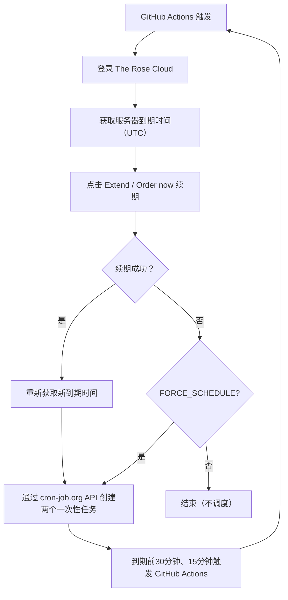

# 🌹 The Rose Cloud 自动续期

通过 GitHub Actions 自动化续期 [The Rose Cloud](https://therose.cloud/) 服务器，并利用 **cron-job.org** 精准触发，彻底解决 GitHub 内置 `schedule` 延迟问题。

---

## ✨ 功能特点

- ✅ **全自动续期**：登录面板 → 点击续期 → 确认成功，全程无人值守。
- 🕒 **精准调度**：使用 cron-job.org API 创建一次性任务，在到期前 **20 分钟** 和 **10 分钟** 自动触发，无需担心 GitHub Actions 的定时延迟。
- 🔁 **循环执行**：续期成功后自动重新计算新的到期时间，并安排下一次触发，形成闭环。
- 🛡️ **支持代理**：可配置 VLESS 代理（通过 sing-box），适用于网络受限环境。
- 📱 **Telegram 通知**：实时推送续期结果和到期时间（北京时间）。
- 🚀 **首次运行友好**：通过 `FORCE_SCHEDULE=true` 强制调度，避免首次执行失败后无法进入循环。

---

## 🔧 工作原理



- **当前运行**：脚本执行登录、续期、获取新到期时间。
- **调度安排**：续期成功后（或强制模式开启），调用 cron-job.org API 创建两个一次性定时任务，分别设置在到期时间前 30 分钟和 15 分钟触发。
- **下次触发**：当 cron-job.org 到达指定时间，向 GitHub API 发送 `workflow_dispatch` 请求，启动新一轮工作流。

---

## 📦 准备工作

1. **cron-job.org 账号**  
   - 注册 [cron-job.org](https://cron-job.org)。
   - 进入控制台 → **Authorization** → 生成 API 密钥（Bearer Token）。

2. **GitHub Personal Access Token**  
   - 生成具有 `repo` 权限的 [经典 PAT](https://github.com/settings/tokens)（勾选 `repo` 范围）。

3. **The Rose Cloud 账号**  
   - 注册并获取登录邮箱和密码。

4. **（可选）Telegram Bot**  
   - 创建 Bot 并获取 `BOT_TOKEN` 和 `CHAT_ID`，用于接收通知。

---

## ⚙️ 环境变量配置

在 GitHub 仓库的 **Settings → Secrets and variables → Actions → Secrets** 中添加以下变量：

| 变量名 | 是否必填 | 说明 |
|--------|----------|------|
| `EMAIL` | ✅ | The Rose Cloud 登录邮箱 |
| `PASSWORD` | ✅ | The Rose Cloud 登录密码 |
| `CRONJOB_API_KEY` | ✅（启用调度） | cron-job.org API 密钥 |
| `GH_TOKEN` | ✅（启用调度） | GitHub Personal Access Token（`repo` 权限） |
| `GH_REPO` | ✅（启用调度） | 仓库全名，如 `your-username/your-repo` |
| `GH_WORKFLOW_ID` | ✅（启用调度） | 工作流文件名，如 `renew.yml` |
| `TG_BOT_TOKEN` | ❌ | Telegram Bot Token（可选） |
| `TG_CHAT_ID` | ❌ | Telegram 接收 ID（可选） |
| `NODE_LINK` | ❌ | VLESS 代理链接（如需代理，格式 `vless://...`） |
| `FORCE_SCHEDULE` | ❌ | 首次运行强制调度，设为 `"true"` |

> **注意**：`FORCE_SCHEDULE` 默认为 `false`，仅在需要强制调度时设置为 `"true"`（例如首次部署）。

---

## 🚀 部署到 GitHub Actions

1. **Fork 本仓库** 或将脚本文件放入您的仓库。
2. **配置 Secrets**（见上表）。
3. **启用工作流**：默认仅在 `workflow_dispatch` 手动触发，您可以取消 `renew.yml` 中 `schedule` 的注释以增加一个备用定期触发（但主要依靠 cron-job.org）。
4. **首次运行**：手动触发一次工作流（Actions → Run workflow），确保 `FORCE_SCHEDULE=true` 以建立循环。
5. **后续**：将 `FORCE_SCHEDULE` 改为 `false` 或删除，避免非正常调度。

---

## 🖥️ 本地运行（调试用）

```bash
# 安装依赖
pip install seleniumbase requests

# 设置环境变量（示例）
export EMAIL="your-email@example.com"
export PASSWORD="your-password"
export CRONJOB_API_KEY="your-api-key"
export GH_TOKEN="your-gh-token"
export GH_REPO="your-username/your-repo"
export GH_WORKFLOW_ID="renew.yml"
export FORCE_SCHEDULE="true"   # 可选

# 运行脚本（需要 X11 或虚拟显示）
python script.py
```

若需代理，设置 `PROXY_SERVER=socks5://127.0.0.1:1080`（可由 `NODE_LINK` 自动配置）。

---

## 📁 文件结构

```
.
├── .github/
│   └── workflows/
│       └── renew.yml          # GitHub Actions 工作流
├── script.py                  # 主续期脚本
└── README.md                  # 本文件
```

---

## ⚠️ 注意事项

- **时区**：网站显示的到期时间为 **UTC**，脚本直接使用 UTC 计算调度，Telegram 通知会转换为北京时间显示。
- **验证码**：脚本使用 SeleniumBase 的 `uc_gui_click_captcha()` 处理 Turnstile，在无头模式下可能失败。GitHub Actions 中使用 `xvfb-run` 模拟图形环境，可正常运行。
- **调度频率**：cron-job.org 免费版每日 100 次 API 调用，本方案每次续期创建 2 个任务（每天约 8 个），远低于限制。
- **令牌过期**：`GH_TOKEN` 和 `CRONJOB_API_KEY` 均有有效期，请及时轮换。
- **首次运行**：务必设置 `FORCE_SCHEDULE=true`，否则若续期失败将无法建立循环。

---

## 📄 许可证

MIT License © 2026 [Your Name]

---

## 🤝 贡献

欢迎提交 Issue 或 Pull Request，共同完善此工具。

---

**祝您使用愉快！** 如有问题，请提交 Issue 或联系作者。
